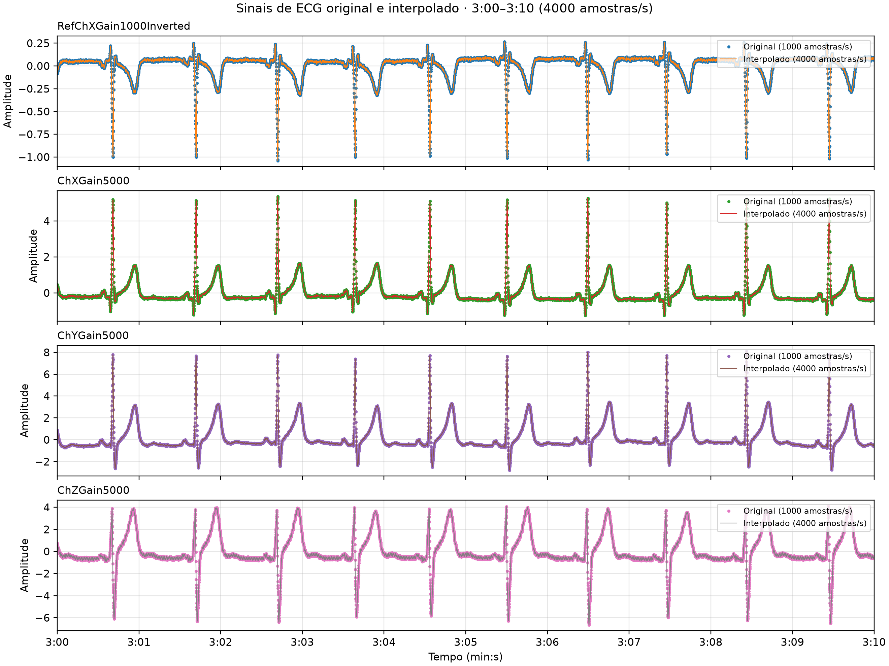
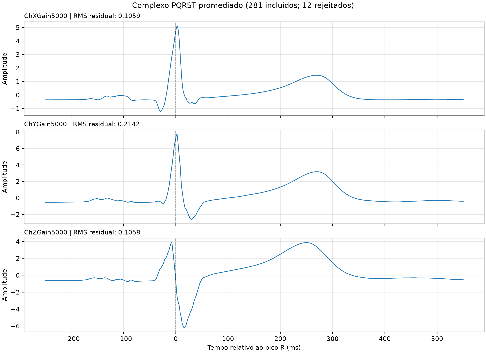
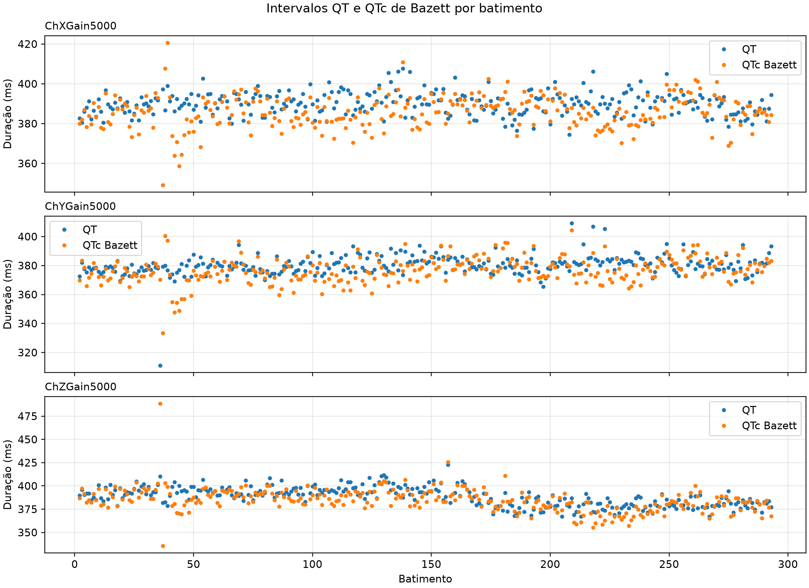

# Relatório do trabalho

[`PDS_Homework202xB.pdf`](PDS_Homework202xB.pdf)

A partir do [sinal de ECG de três canais, X, Y e Z simultâneos](<ECG_XYZ.txt(fs=1000Hz)>), dado em aula com cinco (5) minutos de duração e amostrado a 1000 amostras/seg., desenvolva os algoritmos e faça as implementações para realizar as seguintes operações:

## Item a — Interpolação do sinal

> Interpole o sinal original para 4000 amostras/s. Fazer o gráfico para ambos os sinais no intervalo de 3:00 a 3:10 minutos (marcando as amostras).

### Metodologia

O sinal foi interpolado para uma frequência de amostragem de 4000 amostras por segundo, preservando a duração do registro. A interpolação linear foi calculada com a biblioteca NumPy. Para comparar os sinais, foi selecionado o intervalo entre 3:00 e 3:10 minutos. Os três canais foram apresentados em gráficos separados, com as amostras originais marcadas e o sinal interpolado sobreposto.

### Resultado e análise

A interpolação fornece uma representação temporal mais densa do ECG, mantendo visíveis as amostras do registro original para comparação. O gráfico permite observar os canais no intervalo solicitado e verificar visualmente como a interpolação representa o sinal entre as amostras originais.

## Item b — Detecção, alinhamento e média dos complexos PQRST

> Desenvolva um algoritmo para detectar cada batimento, enquadrar, alinhar e promediar o complexo PQRST; apresentando o sinal promediado, número de complexos incluídos na promediação, número de rejeitados, estimativa do ruído residual, calcular o vetor magnitude utilizando as seguintes frequências passa-alta em 25, 40 e 80 Hz.

### Metodologia

A análise foi realizada sobre o sinal interpolado a 4000 amostras por segundo. A filtragem digital e a detecção de picos foram realizadas com SciPy, e os cálculos numéricos multicanais com NumPy. Para localizar os batimentos, o canal Y foi filtrado por um filtro Butterworth passa-banda de fase nula, de ordem 3 e frequências de corte de 5 e 25 Hz. A detecção exigiu uma distância mínima de 400 ms entre picos e uma proeminência de pelo menos dois desvios-padrão. Para cada pico R, foi extraída uma janela de 250 ms antes e 550 ms depois do pico. Janelas incompletas nas bordas do registro foram rejeitadas.

Para reduzir a influência de batimentos discrepantes, cada janela multicanal foi centralizada e normalizada, e sua correlação com um molde mediano foi calculada. Foram aceitos os complexos com correlação de pelo menos 0,90 e acima do limite inferior definido pelo critério de Tukey. Como as janelas são referenciadas ao pico R, os complexos ficam alinhados temporalmente; a média dos complexos aceitos forma o sinal promediado. O ruído residual foi estimado pelo RMS da diferença entre cada complexo aceito e o complexo médio, separadamente para cada canal.

Para obter os vetores magnitude, foram aplicados filtros Butterworth passa-alta de ordem 3 e fase nula, com frequências de corte de 25, 40 e 80 Hz, aos três canais. Em cada frequência, os complexos filtrados foram promediados e combinados amostra a amostra pelo cálculo da raiz da soma dos quadrados dos três canais.

### Resultados e análise

Foram detectados 293 complexos. Desses, 281 foram incluídos na média e 12 rejeitados: um por estar incompleto na borda do registro e 11 por divergência morfológica. Os RMS residuais foram 0,1059 no canal X, 0,2142 no canal Y e 0,1058 no canal Z. O canal Y apresentou o maior resíduo entre os três canais.

Os gráficos mostram o complexo PQRST médio, os resíduos por canal e os vetores magnitude obtidos com os três cortes passa-alta. A comparação entre as frequências permite observar como o conteúdo do vetor magnitude muda conforme componentes de frequências mais baixas são removidos pelo filtro.

## Item c — Intervalos RR

> Determine em milissegundos todos os intervalos RR consecutivos do registro e faça o gráfico RR x Tempo.

### Metodologia

Foram usados os picos R detectados no item b. Para cada par de picos consecutivos, calculou-se a diferença temporal em milissegundos. Cada intervalo foi associado ao ponto médio entre os instantes dos dois picos delimitadores para compor o gráfico RR em função do tempo.

### Resultados e análise

Foram calculados 292 intervalos RR a partir dos 293 picos detectados. Os intervalos variaram de 705,25 ms a 1294,75 ms. O gráfico apresenta a evolução dos intervalos ao longo do registro e permite visualizar a variabilidade temporal entre batimentos consecutivos.

## Item d — Intervalos QT, QTc e duração do QRS

> Desenvolva um algoritmo (utilizando qualquer conteúdo teórico estudado na disciplina) para detectar todos os intervalos QT nos três canais do ECG. Depois calcule o QT corrigido (QTc) usando os métodos disponíveis na literatura (mas é preciso comparar com a correção definida por Bazett). Determine também a duração do QRS, o intervalo QT e QTc para o sinal promediado.

### Metodologia

Foram reutilizados os picos R identificados no item b, comuns aos três canais. Cada canal foi processado de modo independente por um filtro Butterworth passa-banda de fase nula, de ordem 3, com cortes em 0,5 e 40 Hz, para reduzir a deriva de linha de base e o ruído de alta frequência sem deslocar os marcadores temporais.

O início e o fim de cada QRS foram delimitados pela magnitude da derivada temporal do sinal filtrado, suavizada por média móvel de 10 ms. O limiar de atividade combinou quatro desvios robustos acima do ruído medido entre 250 e 120 ms antes de R e 8% do máximo de atividade na janela de -120 a +160 ms em torno de R. O segmento de atividade conectado mais próximo de R foi adotado como QRS. Delineações cuja duração estivesse fora de 40 a 200 ms foram rejeitadas.

O fim da onda T foi determinado pelo método do limiar da derivada. Após o fim do QRS, procurou-se o máximo da onda T entre 40 ms após o QRS e o menor dos limites de 600 ms após R ou 100 ms antes do próximo R. A polaridade foi inferida pelo maior desvio em relação à linha de base. A derivada, suavizada em 8 ms e orientada para a porção descendente de T, foi comparada a um limiar formado pelo ruído pré-QRS mais três desvios robustos, limitado inferiormente a 5% da maior inclinação da descida. O primeiro trecho de 20 ms continuamente abaixo desse limiar definiu o fim de T. O intervalo QT foi calculado entre o início de QRS e esse marcador.

Para cada QT válido, empregou-se o RR precedente. Foram calculadas as correções de Bazett, QTc = QT / √RR; Fridericia, QTc = QT / ∛RR; e Framingham, QTc = QT + 0,154 × (1 - RR), usando segundos nas fórmulas. No complexo médio, foi utilizado o RR médio de 1021,04 ms para as três correções. O mesmo procedimento de delineação foi aplicado separadamente aos seus três canais.

### Resultados

Foram avaliadas 879 combinações de batimento e canal. Obtiveram-se 875 intervalos QT válidos: os três primeiros complexos não dispunham da janela pré-R integral para estimativa de ruído e uma delineação do canal X foi rejeitada por resultar em QRS de 279,75 ms. As médias dos intervalos foram, respectivamente para os canais X, Y e Z: QRS de 80,36, 91,27 e 109,89 ms; QT de 389,99, 380,40 e 388,32 ms; QTc de Bazett de 385,95, 376,69 e 384,56 ms; QTc de Fridericia de 387,27, 377,90 e 385,79 ms; e QTc de Framingham de 386,58, 377,16 e 385,08 ms.

No complexo médio, os valores foram: QRS de 80,25, 91,25 e 109,25 ms; QT de 408,50, 396,75 e 411,25 ms; QTc de Bazett de 404,27, 392,64 e 406,99 ms; QTc de Fridericia de 405,67, 394,01 e 408,41 ms; e QTc de Framingham de 405,26, 393,51 e 408,01 ms, para X, Y e Z, respectivamente.

### Análise

As três correções produziram valores próximos porque o RR médio foi próximo de um segundo, condição em que as fórmulas convergem. Bazett apresentou valores ligeiramente menores que Fridericia e Framingham neste registro. As diferenças entre canais refletem as diferentes projeções do vetor cardíaco e, principalmente, a dificuldade inerente de definir o retorno de T à linha de base em cada derivação. O método de limiar da derivada evita definir esse ponto diretamente pela amplitude, mas ainda depende de boa relação sinal-ruído e pode falhar em ondas T muito pequenas, bifásicas ou fundidas com outra onda; por isso, as rejeições foram mantidas explicitamente nos resultados.

O aumento observado nos intervalos QT e QTc dos complexos promediados, em comparação com as médias individuais dos batimentos, pode estar relacionado ao processo de promediação, que reduz a influência de ruídos e variações morfológicas entre os batimentos, tornando as transições das ondas P, QRS e T mais definidas. Essa alteração pode influenciar a identificação dos pontos de início e término das ondas, especialmente do término da onda T, resultando em intervalos QT ligeiramente maiores. O efeito foi consistente nos três canais, com aumentos de aproximadamente 18,51 ms no canal X, 16,35 ms no canal Y e 22,93 ms no canal Z. Portanto, embora a promediação favoreça a delineação ao melhorar a relação sinal-ruído, os resultados indicam que as medidas obtidas no complexo médio não são necessariamente equivalentes à média das medidas individuais.

## Item e

Ainda não implementado.

## Item f

Ainda não implementado.

## Item g

Ainda não implementado.
