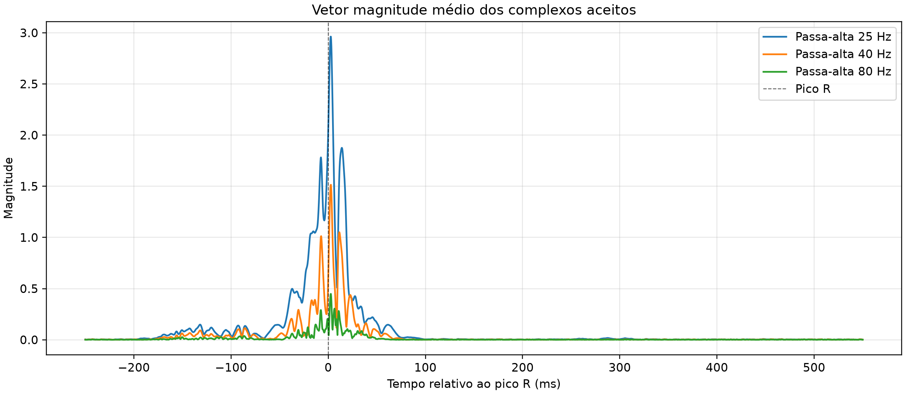
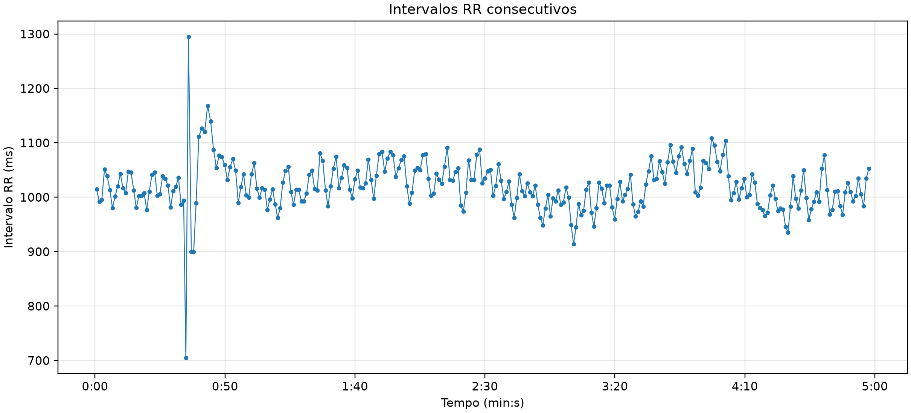

# Relatório do trabalho

[`PDS_Homework202xB.pdf`](PDS_Homework202xB.pdf)

A partir do [sinal de ECG de três canais, X, Y e Z simultâneos](<ECG_XYZ.txt(fs=1000Hz)>), dado em aula com cinco (5) minutos de duração e amostrado a 1000 amostras/seg., desenvolva os algoritmos e faça as implementações para realizar as seguintes operações:

## Item a — Interpolação do sinal

> Interpole o sinal original para 4000 amostras/s. Fazer o gráfico para ambos os sinais no intervalo de 3:00 a 3:10 minutos (marcando as amostras).

### Metodologia

O sinal foi interpolado para uma frequência de amostragem de 4000 amostras por segundo, preservando a duração do registro. A interpolação linear foi calculada com a biblioteca NumPy. Para comparar os sinais, foi selecionado o intervalo entre 3:00 e 3:10 minutos. Os três canais foram apresentados em gráficos separados, com as amostras originais marcadas e o sinal interpolado sobreposto.

### Resultado e análise

A interpolação fornece uma representação temporal mais densa do ECG, mantendo visíveis as amostras do registro original para comparação. O gráfico permite observar os canais no intervalo solicitado e verificar visualmente como a interpolação representa o sinal entre as amostras originais.

## Item b — Detecção, alinhamento e média dos complexos PQRST

> Desenvolva um algoritmo para detectar cada batimento, enquadrar, alinhar e promediar o complexo PQRST; apresentando o sinal promediado, número de complexos incluídos na promediação, número de rejeitados, estimativa do ruído residual, calcular o vetor magnitude utilizando as seguintes frequências passa-alta em 25, 40 e 80 Hz.

### Metodologia

A análise foi realizada sobre o sinal interpolado a 4000 amostras por segundo. A filtragem digital e a detecção de picos foram realizadas com SciPy, e os cálculos numéricos multicanais com NumPy. Para localizar os batimentos, o canal Y foi filtrado por um filtro Butterworth passa-banda de fase nula, de ordem 3 e frequências de corte de 5 e 25 Hz. A detecção exigiu uma distância mínima de 400 ms entre picos e uma proeminência de pelo menos dois desvios-padrão. Para cada pico R, foi extraída uma janela de 250 ms antes e 550 ms depois do pico. Janelas incompletas nas bordas do registro foram rejeitadas.

Para reduzir a influência de batimentos discrepantes, cada janela multicanal foi centralizada e normalizada, e sua correlação com um molde mediano foi calculada. Foram aceitos os complexos com correlação de pelo menos 0,90 e acima do limite inferior definido pelo critério de Tukey. Como as janelas são referenciadas ao pico R, os complexos ficam alinhados temporalmente; a média dos complexos aceitos forma o sinal promediado. O ruído residual foi estimado pelo RMS da diferença entre cada complexo aceito e o complexo médio, separadamente para cada canal.

Para obter os vetores magnitude, foram aplicados filtros Butterworth passa-alta de ordem 3 e fase nula, com frequências de corte de 25, 40 e 80 Hz, aos três canais. Em cada frequência, os complexos filtrados foram promediados e combinados amostra a amostra pelo cálculo da raiz da soma dos quadrados dos três canais.

### Resultados e análise

Foram detectados 293 complexos. Desses, 281 foram incluídos na média e 12 rejeitados: um por estar incompleto na borda do registro e 11 por divergência morfológica. Os RMS residuais foram 0,1059 no canal X, 0,2142 no canal Y e 0,1058 no canal Z. O canal Y apresentou o maior resíduo entre os três canais.

Os gráficos mostram o complexo PQRST médio, os resíduos por canal e os vetores magnitude obtidos com os três cortes passa-alta. A comparação entre as frequências permite observar como o conteúdo do vetor magnitude muda conforme componentes de frequências mais baixas são removidos pelo filtro.

## Item c — Intervalos RR

> Determine em milissegundos todos os intervalos RR consecutivos do registro e faça o gráfico RR x Tempo.

### Metodologia

Foram usados os picos R detectados no item b. Para cada par de picos consecutivos, calculou-se a diferença temporal em milissegundos. Cada intervalo foi associado ao ponto médio entre os instantes dos dois picos delimitadores para compor o gráfico RR em função do tempo.

### Resultados e análise

Foram calculados 292 intervalos RR a partir dos 293 picos detectados. Os intervalos variaram de 705,25 ms a 1294,75 ms. O gráfico apresenta a evolução dos intervalos ao longo do registro e permite visualizar a variabilidade temporal entre batimentos consecutivos.

## Item d

Ainda não implementado.

## Item e

Ainda não implementado.

## Item f

Ainda não implementado.

## Item g

Ainda não implementado.
