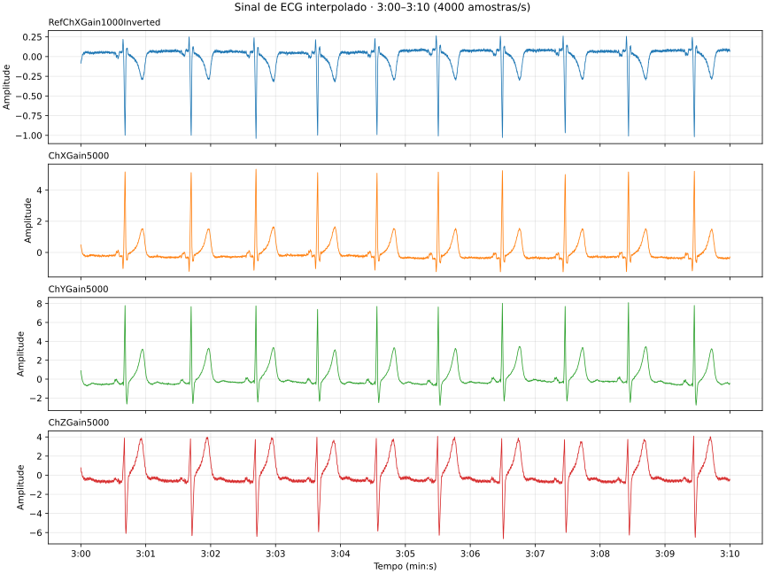

# Relatório do trabalh

## Enunciado do item 1

[`PDS_Homework202xB.pdf`](PDS_Homework202xB.pdf)

A partir do [sinal de ECG de três canais, X, Y e Z simultâneos](<ECG_XYZ.txt(fs=1000Hz)>), dado em aula com cinco (5) minutos de duração e amostrado a 1000 amostras/seg., desenvolva os algoritmos e faça as implementações para realizar as seguintes operações:

## Item a

> Interpole o sinal original para 4000 amostras/s. Fazer o gráfico para ambos os sinais no intervalo de 3:00 a 3:10 minutos (marcando as amostras).

### Dados de entrada

Foi utilizado o arquivo [`ECG_XYZ.txt(fs=1000Hz)`](<ECG_XYZ.txt(fs=1000Hz)>), que contém as amostras do ECG original e a coluna `SamplingInterval`, com o tempo em segundos. A frequência original indicada no arquivo é 1000 amostras/s.

### O que foi implementado

O código principal em [`main.py`](main.py) carrega o arquivo de entrada, chama as funções do item a e coordena a gravação dos resultados. As funções de interpolação e plotagem estão em [`item_a/utils.py`](item_a/utils.py).

A função `interpolar_dados` cria uma nova grade temporal com intervalo de 1/4000 s e interpola cada canal usando `numpy.interp`. O resultado é salvo em [`item_a/ECG_XYZ_4000Hz.csv`](item_a/ECG_XYZ_4000Hz.csv).

A função `plotar_sinal_ecg` gera o gráfico dos canais interpolados no intervalo de 180 a 190 segundos (3:00 a 3:10), usando um subplot e uma cor diferente para cada canal. O gráfico é salvo em [`item_a/ECG_03-00_a_03-10.svg`](item_a/ECG_03-00_a_03-10.svg).

#### Gráfico gerado

### Observação sobre o enunciado

O gráfico atualmente gerado apresenta os canais interpolados. O enunciado também solicita mostrar ambos os sinais — original e interpolado — e marcar as amostras. Essas duas partes ainda não estão representadas no gráfico atual.

## Item b

## Item c

## Item d

## Item e

## Item f

## Item g

## Padrões do repositório

As instruções para organização do código, documentação das funções e atualização deste relatório estão registradas em [`AGENTS.md`](AGENTS.md).
